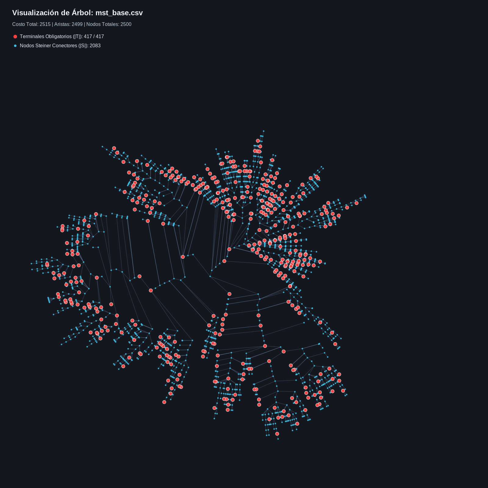
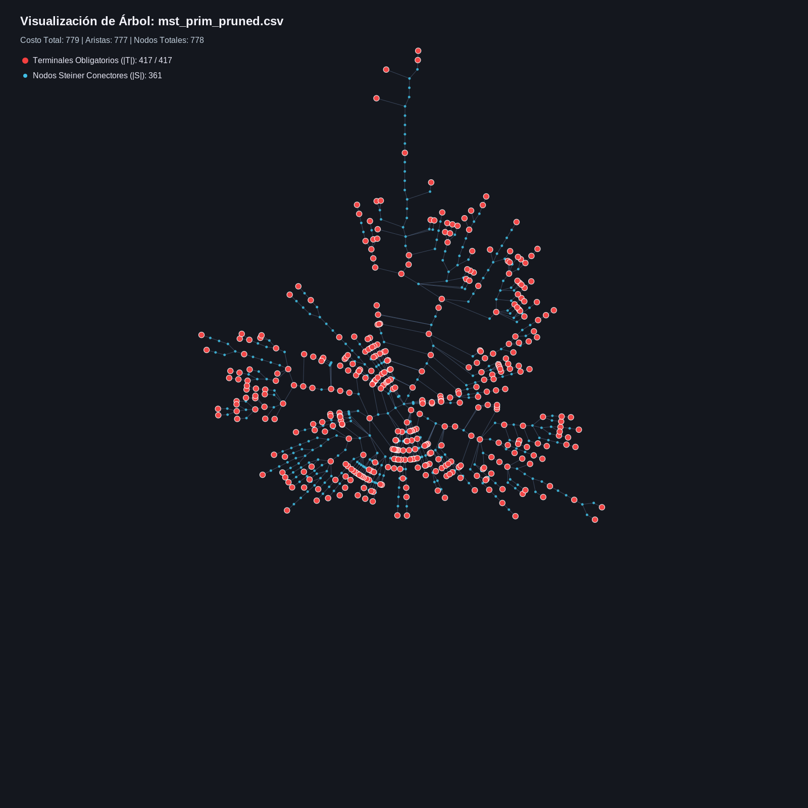
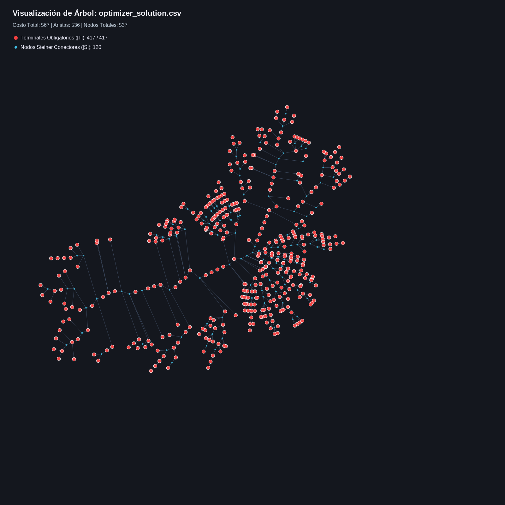
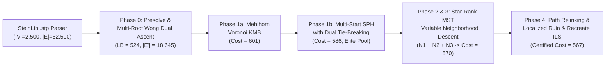

# High-Performance Steiner Tree Solver in C++17

[](https://en.cppreference.com/w/cpp/17)
[](https://opensource.org/licenses/MIT)
[](#quick-start)

A zero-dependency **C++17** heuristic and metaheuristic optimization engine for the **NP-Hard Steiner Tree Problem in Graphs (STPG)** on standard **SteinLib (`.stp`)** benchmarks.

Evaluated on Beasley's classic **`e18.stp`** benchmark ($|V| = 2,500$ vertices, $|E| = 62,500$ weighted undirected edges, $|T| = 417$ mandatory terminals), the solver reduces the total tree cost from **$2,515$ (base MST)** down to a certified **$567$ ($-77.46\%$ reduction, within $+0.53\%$ of the $564$ theoretical global optimum)** without relying on external MIP/ILP solvers (such as Gurobi or CPLEX).

---

## Visual Progression on SteinLib `e18.stp`

The solver includes an automated radial-tree visualization tool (`scripts/plot_tree.py`) that renders mandatory terminal vertices in **coral red** and optional Steiner connector vertices in **cyan**:

| Base MST (`Cost = 2,515`) | Terminal-Prioritized Pruned Prim (`Cost = 779`) | Multi-Stage Metaheuristic (`Cost = 567`) |
| :---: | :---: | :---: |
|  |  |  |
| $2,499$ edges / $2,083$ Steiner nodes | $777$ edges / $361$ Steiner nodes ($-69.03\%$) | **$536$ edges / $120$ Steiner nodes ($-77.46\%$)** |

---

## Algorithmic Pipeline



### Key Techniques Implemented

1. **Exact Baselines & Linear-Time Leaf Peeling (`src/mst.*`):**
   - **Kruskal's MST** with Path-Compression / Union-by-Rank DSU (`src/dsu.hpp`) and **Prim's MST** with terminal-prioritized min-heap tie-breaking (`prefer_terminals = true`), which concentrates non-terminal vertices toward tree leaves.
   - **$O(|V| + |E|)$ Iterative Steiner Leaf Pruning:** Degree-queue peeling of degree-1 non-terminal vertices, reducing Kruskal from $2,515 \to 1,005$ and terminal-prioritized Prim from $2,515 \to 779$ in $< 0.5\text{ ms}$.
2. **Phase 0 — Graph Reduction & Multi-Root Wong Dual Ascent (`src/optimizer.cpp`):**
   - Prunes 2-hop dominated edges and edges exceeding the MST bottleneck bound (shrinking `e18.stp` from $62,500$ to $18,645$ active edges).
   - Executes multi-root directed cut **Dual Ascent** to establish a mathematical lower bound ($\text{LB} = 524$) and record edge dual-saturation frequencies used to guide subsequent heuristics.
3. **Phase 1 — Constructive Heuristics (`src/optimizer.cpp`):**
   - **Mehlhorn's Voronoi KMB ($O(|E| \log |V|)$):** Multi-source Dijkstra partitioning the graph into terminal Voronoi regions, followed by Kruskal over inter-region boundary edges (cost $601$ in $45\text{ ms}$).
   - **Multi-Start Shortest Path Heuristic (Takahashi-Matsuyama SPH):** Grows trees iteratively from up to $|T| = 417$ terminal roots using dual-saturation and terminal-affinity tie-breaking, populating a diverse elite pool of size 18 (cost $586$).
4. **Phase 2 & 3 — Canonical *Star-Rank MST* Decoder & Variable Neighborhood Descent (VND):**
   - **Two-Pass Star-Rank MST Evaluator:** Ranks active Steiner vertices by degree-1 terminal saturation so redundant connectors are forced into degree-1 leaves and automatically pruned rather than forming degree-2 chains.
   - **$N_1$ (k-Star Insertion & Bridge Expansion):** Inserts 1-star, 2-star, and 3-star Steiner hubs across DSU super-components.
   - **$N_2$ (Branching Steiner Elimination & Swap):** Removes or swaps Steiner vertices of degree $\ge 3$.
   - **$N_3$ (Exact Key-Path Replacement):** Removes key-paths and reconnects split tree components via bounded multi-source Dijkstra (reduces cost to $570$).
5. **Phase 4 — Path Relinking & Iterated Local Search (ILS):**
   - **Elite Pool Path Relinking:** Explores intermediate subsets of Steiner vertices along symmetric-difference trajectories between elite solutions ($570 \to 568$).
   - **Localized *Ruin & Recreate* ILS:** Perturbs localized BFS balls around structural weak spots (degree-2 Steiner nodes and higher-weight edges), repairs the forest via randomized SPH + VND, and compacts remaining degree-2 bridges to reach **cost $567$**.
6. **Formal Solution Validator (`src/validator.*`):**
   - Certifies every stage against 5 strict invariants: (1) all edges exist in $G$ with authentic weights, (2) 100% terminal coverage $T \subseteq V(T_S)$, (3) single connected component via BFS, (4) tree edge count $|E(T_S)| = |V(T_S)| - 1$, and (5) acyclicity via DSU plus zero remaining Steiner leaves.

---

## Benchmark Progression (`data/e18.stp`)

*Instance parameters: $|V| = 2,500$, $|E| = 62,500$, $|T| = 417$, known global optimum $C^* = 564$. Compiled with `g++ -O3 -std=c++17`.*

| Stage / Algorithm | Cost | Reduction vs. Base MST | Gap vs. Optimum ($564$) | Edges / Steiner Nodes | Execution Time |
| :--- | :---: | :---: | :---: | :---: | :---: |
| **Kruskal / Prim Base MST** | $2,515$ | $0.00\%$ | $+345.92\%$ | $2,499$ / $2,083$ | $\sim 9\text{ ms}$ |
| **Pruned Kruskal (Leaf Peeling)** | $1,005$ | $-60.04\%$ | $+78.19\%$ | $1,003$ / $587$ | $0.87\text{ ms}$ |
| **Pruned Prim (Standard)** | $922$ | $-63.34\%$ | $+63.48\%$ | $920$ / $504$ | $0.42\text{ ms}$ |
| **Pruned Prim (Terminal Tie-Breaking)** | **$779$** | **$-69.03\%$** | **$+38.12\%$** | $777$ / $361$ | $0.48\text{ ms}$ |
| **Phase 0: Wong Dual Ascent (Lower Bound)** | $524$ *(LB)* | — | $-7.09\%$ *(LB)* | $18,645$ active edges | $38.5\text{ ms}$ |
| **Phase 1a: Mehlhorn Voronoi KMB** | $601$ | $-76.10\%$ | $+6.56\%$ | $551$ / $135$ | $45.2\text{ ms}$ |
| **Phase 1b: Multi-Start SPH ($417$ roots)** | $586$ | $-76.70\%$ | $+3.90\%$ | $545$ / $129$ | $1.11\text{ s}$ |
| **Phase 2 & 3: Star-Rank VND ($N_1 + N_2 + N_3$)** | $570$ | $-77.34\%$ | $+1.06\%$ | $563$ / $147$ | $9.00\text{ s}$ |
| **Phase 4a: Elite Pool Path Relinking** | $568$ | $-77.42\%$ | $+0.71\%$ | $563$ / $147$ | $18.42\text{ s}$ |
| **Phase 4b: Localized ILS (*Ruin & Recreate*)** | **$567$** | **$-77.46\%$** | **$+0.53\%$** | **$536$ / $120$** | **$40.60\text{ s}$** |

---

## Quick Start

### 1. Build & Run Solver

```bash
# Compile with -O3 optimizations
make

# Run full benchmark pipeline on SteinLib E18 (default)
./steiner_solver

# Run with custom ILS iterations, time budget (ms), and PRNG seed
./steiner_solver data/e18.stp --iter 150 --time-limit 45000 --seed 1337 --optimum 564
```

### 2. Run Unit & Integration Tests

```bash
make test
```

### 3. Generate Tree Visualizations (SVG & PNG)

```bash
# Generates SVG (and high-res PNG if pycairo is installed) in report/figures/
python3 scripts/plot_tree.py --stp data/e18.stp --input-dir results --output-dir report/figures
```

---

## Repository Structure

```text
steiner-tree-solver/
├── data/
│   └── e18.stp                 # SteinLib E18 benchmark instance (|V|=2500, |E|=62500, |T|=417)
├── src/
│   ├── dsu.hpp                 # 1-indexed Disjoint Set Union (path compression + union by rank)
│   ├── graph.hpp / .cpp        # SteinLib .stp parser, adjacency structures, Dijkstra & metric closure
│   ├── mst.hpp / .cpp          # Kruskal, terminal-prioritized Prim, and O(|V|+|E|) Steiner leaf pruning
│   ├── optimizer.hpp / .cpp    # Presolve, Wong Dual Ascent, Voronoi KMB, Multi-SPH, VND, PR & ILS
│   ├── validator.hpp / .cpp    # Formal Steiner tree verifier and CSV exporter
│   └── main.cpp                # CLI entry point and stage-by-stage benchmark runner
├── tests/
│   └── test_solver.cpp         # Unit & integration test suite (DSU, Validator, MST, Optimizer)
├── scripts/
│   └── plot_tree.py            # Radial BFS tree layout & dark-theme SVG/PNG renderer
├── results/                    # Exported solution edge lists (CSV)
├── report/
│   ├── main.tex                # Technical paper with formal proofs & complexity analysis (LaTeX)
│   ├── references.bib          # Bibliography (Karp, Kou-Markowsky-Berman, Mehlhorn, Wong, etc.)
│   └── figures/                # Generated SVG & PNG tree visualizations
└── Makefile                    # Build and test automation
```
